# PRAKTIKUM JARKOM MODUL 4 KELOMPOK K-02 - 2026

## Anggota Kelompok

| Nama | NRP |
| :--- | :--- |
| Maulana Zaki Putra Zakaria | 5027251009 |
| Naila Anggun Eka Rizqy | 5027251122 |

## Laporan

[LINK SPREADSHEET]
https://docs.google.com/spreadsheets/d/1w6Mh8W8C_vjY8R0xVzYc2j1f4y1E8o/edit?usp=sharing

---

### CPT - VLSM

*(Bagian Cisco Packet Tracer & perhitungan VLSM akan diperbarui setelah pengerjaan selesai)*

---

### GNS3 - CIDR

Pada topologi GNS3 diterapkan metode **CIDR (Classless Inter-Domain Routing)** dengan prefix kelompok **`192.212.x.x`** dan Root Supernet **`192.212.0.0/19`**. Fokus utama CIDR adalah efisiensi alokasi alamat dan agregasi rute (*route summarization*).

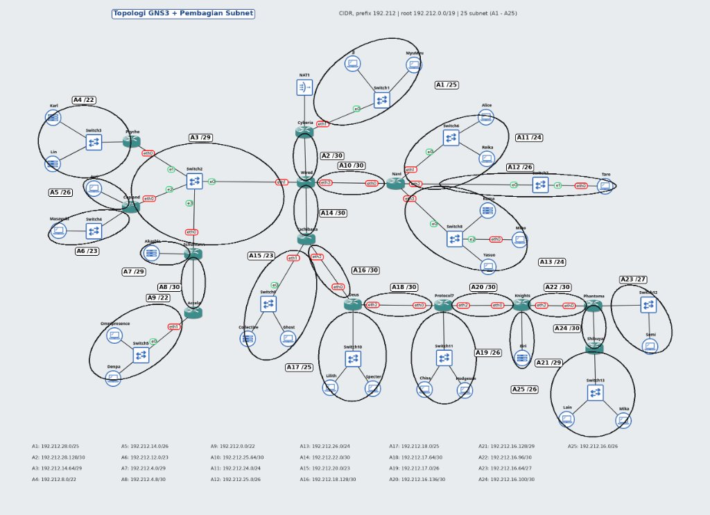

1. **Topologi Jaringan GNS3**

   Jaringan "The Wired Expansion" dibagi menjadi 3 wilayah percabangan utama yang berpusat pada Router Backbone **`Wired`** dan Router Gateway **`Cyberia`**:
   - **Sayap Kiri:** Hub Switch2 (`Psyche`, `Copland`, `Schumann`, `Accela`).
   - **Sayap Kanan:** Router `Navi` (`Switch6`, `Switch7`, `Switch8`).
   - **Sayap Bawah:** Rantai Router `Tachibana` $\to$ `Deus` $\to$ `Protocol7` $\to$ `Knights` $\to$ `Phantoma` $\to$ `Shibuya`.

---

2. **Tabel Pembagian IP (CIDR Subnetting Table)**

Total kebutuhan IP jaringan adalah **2814 IP** (termasuk host dan interface router) yang dialokasikan ke dalam **25 Subnet** tanpa adanya overlap:

| Subnet | Jalur / Rute | Kebutuhan IP | Netmask | Network ID | Range Usable IP | Broadcast |
| :---: | :--- | :---: | :---: | :---: | :---: | :---: |
| **A1** | Cyberia > Switch1 > JJ, MyuMyu | 126 | `/25` | `192.212.28.0` | `192.212.28.1 - 192.212.28.126` | `192.212.28.127` |
| **A2** | Cyberia > Wired | 2 | `/30` | `192.212.28.128` | `192.212.28.129 - 192.212.28.130` | `192.212.28.131` |
| **A3** | Wired > Switch2 > Psyche, Copland, Schumann | 4 | `/29` | `192.212.14.64` | `192.212.14.65 - 192.212.14.70` | `192.212.14.71` |
| **A4** | Psyche > Switch3 > Karl, Lin | 881 | `/22` | `192.212.8.0` | `192.212.8.1 - 192.212.11.254` | `192.212.11.255` |
| **A5** | Copland > Juri (Direct) | 32 | `/26` | `192.212.14.0` | `192.212.14.1 - 192.212.14.62` | `192.212.14.63` |
| **A6** | Copland > Switch4 > Masayuki | 301 | `/23` | `192.212.12.0` | `192.212.12.1 - 192.212.13.254` | `192.212.13.255` |
| **A7** | Schumann > Akashic (Direct) | 4 | `/29` | `192.212.4.0` | `192.212.4.1 - 192.212.4.6` | `192.212.4.7` |
| **A8** | Schumann > Accela | 2 | `/30` | `192.212.4.8` | `192.212.4.9 - 192.212.4.10` | `192.212.4.11` |
| **A9** | Accela > Switch5 > Omnipresence, Denpa | 514 | `/22` | `192.212.0.0` | `192.212.0.1 - 192.212.3.254` | `192.212.3.255` |
| **A10** | Wired > Navi | 2 | `/30` | `192.212.25.64` | `192.212.25.65 - 192.212.25.66` | `192.212.25.67` |
| **A11** | Navi > Switch6 > Alice, Reika | 254 | `/24` | `192.212.24.0` | `192.212.24.1 - 192.212.24.254` | `192.212.24.255` |
| **A12** | Navi > Switch7 > Taro | 58 | `/26` | `192.212.25.0` | `192.212.25.1 - 192.212.25.62` | `192.212.25.63` |
| **A13** | Navi > Switch8 > Yasuo, Miho, Kuma | 143 | `/24` | `192.212.26.0` | `192.212.26.1 - 192.212.26.254` | `192.212.26.255` |
| **A14** | Wired > Tachibana | 2 | `/30` | `192.212.22.0` | `192.212.22.1 - 192.212.22.2` | `192.212.22.3` |
| **A15** | Tachibana > Switch9 > Collective, Ghost | 267 | `/23` | `192.212.20.0` | `192.212.20.1 - 192.212.21.254` | `192.212.21.255` |
| **A16** | Tachibana > Deus | 2 | `/30` | `192.212.18.128` | `192.212.18.129 - 192.212.18.130` | `192.212.18.131` |
| **A17** | Deus > Switch10 > Lilith, Specter | 99 | `/25` | `192.212.18.0` | `192.212.18.1 - 192.212.18.126` | `192.212.18.127` |
| **A18** | Deus > Protocol7 | 2 | `/30` | `192.212.17.64` | `192.212.17.65 - 192.212.17.66` | `192.212.17.67` |
| **A19** | Protocol7 > Switch11 > Chisa, Hodgeson | 33 | `/26` | `192.212.17.0` | `192.212.17.1 - 192.212.17.62` | `192.212.17.63` |
| **A20** | Protocol7 > Knights | 2 | `/30` | `192.212.16.136` | `192.212.16.137 - 192.212.16.138` | `192.212.16.139` |
| **A21** | Knights > Eiri (Direct) | 3 | `/29` | `192.212.16.128` | `192.212.16.129 - 192.212.16.134` | `192.212.16.135` |
| **A22** | Knights > Phantoma | 2 | `/30` | `192.212.16.96` | `192.212.16.97 - 192.212.16.98` | `192.212.16.99` |
| **A23** | Phantoma > Switch12 > Semi | 15 | `/27` | `192.212.16.64` | `192.212.16.65 - 192.212.16.94` | `192.212.16.95` |
| **A24** | Phantoma > Shibuya | 2 | `/30` | `192.212.16.100` | `192.212.16.101 - 192.212.16.102` | `192.212.16.103` |
| **A25** | Shibuya > Switch13 > Lain, Mika | 62 | `/26` | `192.212.16.0` | `192.212.16.1 - 192.212.16.62` | `192.212.16.63` |

---

3. **Perhitungan Penggabungan Rute (CIDR Supernetting)**

Penggabungan rute dilakukan secara hierarkis (*bottom-up*) dari subnet terkecil hingga mencapai Root Supernet:

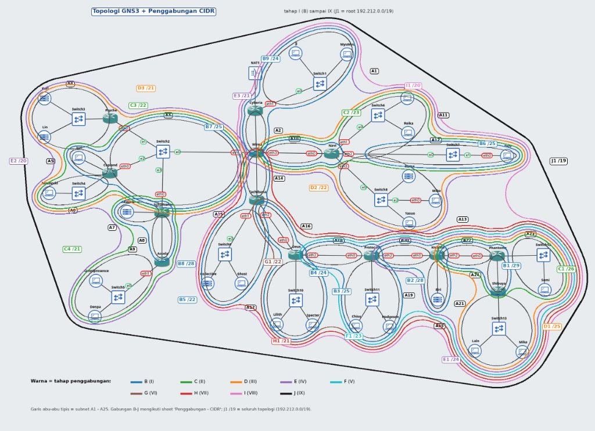

* **Tahap I**:
  - `B1` = A22 + A24 $\to$ `/29` (Link Knights-Phantoma + Phantoma-Shibuya)
  - `B2` = A21 + A20 $\to$ `/28` (Eiri + Link Protocol7-Knights)
  - `B3` = A19 + A18 $\to$ `/25` (LAN Protocol7 + Link Deus-Protocol7)
  - `B4` = A17 + A16 $\to$ `/24` (LAN Deus + Link Tachibana-Deus)
  - `B5` = A15 + A14 $\to$ `/22` (LAN Tachibana + Link Wired-Tachibana)
  - `B6` = A12 + A10 $\to$ `/25` (LAN Taro + Link Wired-Navi)
  - `B7` = A5 + A3 $\to$ `/25` (Juri + Segmen Switch2)
  - `B8` = A7 + A8 $\to$ `/28` (Akashic + Link Schumann-Accela)
  - `B9` = A1 + A2 $\to$ `/24` (LAN Cyberia + Link Cyberia-Wired)
* **Tahap II**:
  - `C1` = A23 + B1 $\to$ `/26` (Semi + B1)
  - `C2` = A11 + B6 $\to$ `/23` (Alice, Reika + B6)
  - `C3` = A6 + B7 $\to$ `/22` (Blok Copland)
  - `C4` = A9 + B8 $\to$ `/21` (Blok Schumann & Accela)
* **Tahap III**:
  - `D1` = A25 + C1 $\to$ `/25` (Blok Phantoma & Shibuya)
  - `D2` = C2 + A13 $\to$ `/22` (Blok Kanan / Navi: `192.212.24.0/22`)
  - `D3` = A4 + C3 $\to$ `/21` (Psyche + Copland)
* **Tahap IV - IX (Supernet Utama)**:
  - `E1` = D1 + B2 $\to$ `/24` (Blok Knights)
  - `E2` = C4 + D3 $\to$ `/20` (Blok Kiri Switch2: `192.212.0.0/20`)
  - `E3` = D2 + B9 $\to$ `/21` (Navi + Cyberia)
  - `F1` = E1 + B3 $\to$ `/23` (Blok Protocol7)
  - `G1` = F1 + B4 $\to$ `/22` (Blok Deus)
  - `H1` = G1 + B5 $\to$ `/21` (Blok Bawah Tachibana: `192.212.16.0/21`)
  - `I1` = H1 + E3 $\to$ `/20`
  - **`J1` (Root Supernet)** = E2 + I1 $\to$ **`192.212.0.0/19`** (Mencakup seluruh jaringan The Wired).

---

4. **Konfigurasi & Routing Efisien**

Setiap node diatur dengan skrip modular di [`routings/gns3/`](./routings/gns3/) dan persistensi sistem dijamin melalui [`scripts/init.sh`](./scripts/init.sh).

Contoh tabel routing ringkas pada Router Backbone **`Wired`**:

```bash
# Default ke internet melalui Cyberia
ip route add default via 192.212.28.129

# Rute agregat ke masing-masing cabang
ip route add 192.212.8.0/22 via 192.212.14.66   # Blok Psyche
ip route add 192.212.12.0/22 via 192.212.14.67  # Blok Copland
ip route add 192.212.0.0/21 via 192.212.14.68   # Blok Schumann
ip route add 192.212.24.0/22 via 192.212.25.66  # Blok Kanan (Navi)
ip route add 192.212.16.0/21 via 192.212.22.2   # Blok Bawah (Tachibana)
```

---

5. **Pengujian Konektivitas (Testing)**

* **Uji Koneksi Internet Gateway pada Router Cyberia**:
  Router Cyberia terhubung ke NAT GNS3 (`NAT1`), menerima IP WAN, dan berhasil melakukan ping keluar ke internet (`8.8.8.8`):

  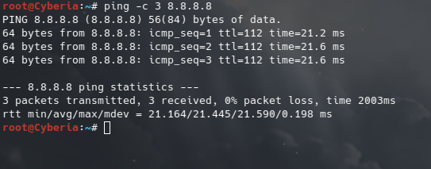
  *(Hasil: 3 packets transmitted, 3 received, 0% packet loss, RTT ~21ms)*

* **Uji Konektivitas Backbone pada Router Wired**:
  Router Wired berhasil terhubung ke Router Cyberia (`192.212.28.129`) dan meneruskan koneksi keluar ke internet (`8.8.8.8`):

  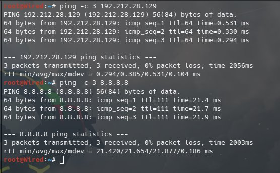
  *(Hasil: Ping ke Cyberia RTT ~0.3ms, Ping ke Internet RTT ~21ms, 0% packet loss)*

* **Uji Konektivitas Client LAN Cyberia (Host JJ)**:
  Client JJ (`192.212.28.2`) berhasil melakukan komunikasi lokal ke Gateway Cyberia (`192.212.28.1`), ke sesama host LAN MyuMyu (`192.212.28.3`), menembus ke Router Backbone Wired (`192.212.28.130`), serta akses penuh ke Internet (`8.8.8.8`):

  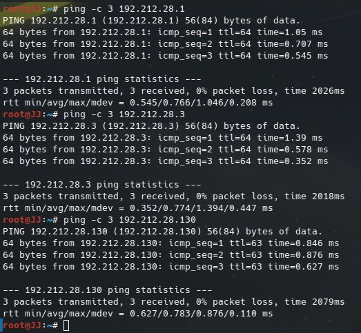
  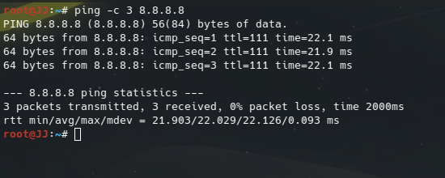
  *(Hasil: 0% packet loss ke seluruh target pengujian)*

* **Uji Konektivitas Router Sayap Kanan (Navi)**:
  Router Navi berhasil terhubung ke Router Backbone Wired (`192.212.25.65`), menembus ke Gateway Cyberia (`192.212.28.1`), menembus ke Client LAN Cyberia JJ (`192.212.28.2`), serta koneksi keluar ke Internet (`8.8.8.8`):

  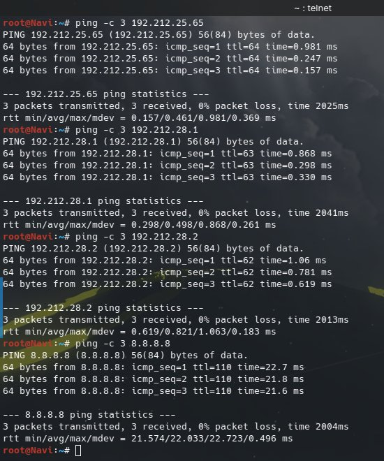
  *(Hasil: 0% packet loss ke seluruh router, host cross-wing, dan internet)*

* **Uji Konektivitas Host Sayap Kanan Lintas Sayap (Cross-Wing Ping - Host Alice)**:
  Host Alice (`192.212.24.2`) di bawah Switch6 berhasil melakukan ping ke Gateway Navi (`192.212.24.1`), ke sesama host di sayap kanan Kuma (`192.212.26.4`), melintasi seluruh backbone ke Client JJ (`192.212.28.2`) di Sayap Cyberia, serta tembus ke Internet (`8.8.8.8`):

  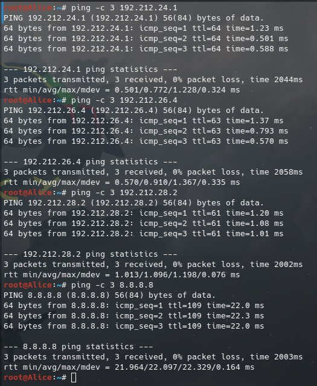
  *(Hasil: 0% packet loss, membuktikan subnetting CIDR dan route summarization Sayap Kanan berjalan presisi)*

* **Uji Konektivitas Router Sayap Kiri Terdalam (Router Accela)**:
  Router Accela (`192.212.4.10`) berhasil melakukan ping ke Router Schumann (`192.212.4.9`), ke Router Backbone Wired (`192.212.14.65`) melalui Switch2, melintasi seluruh jaringan ke Host Alice (`192.212.24.2`) di Sayap Kanan, serta akses ke Internet (`8.8.8.8`):

  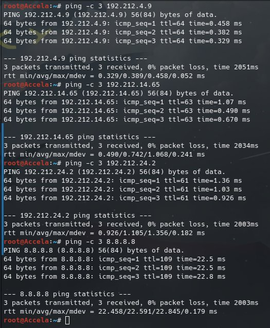
  *(Hasil: 0% packet loss, membuktikan rute multi-access Switch2 dan agregasi Sayap Kiri terhubung utuh)*

* **Uji Konektivitas Host Sayap Kiri Terdalam (Host Omnipresence)**:
  Host Omnipresence (`192.212.0.2`, 510 host di bawah Switch5) berhasil melakukan ping ke Gateway Accela (`192.212.0.1`), ke sesama host Sayap Kiri Karl (`192.212.8.2`), melintasi seluruh jaringan ke Host Alice (`192.212.24.2`) di Sayap Kanan, ke Host JJ (`192.212.28.2`) di LAN Cyberia, serta tembus ke Internet (`8.8.8.8`):

  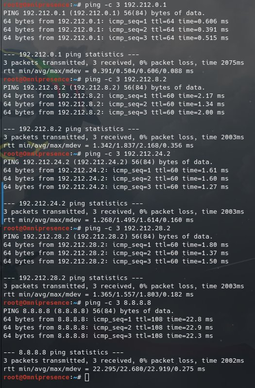
  *(Hasil: 0% packet loss ke seluruh 5 target, membuktikan integritas routing Sayap Kiri sempurna)*

* **Uji Konektivitas Router Sayap Bawah Ujung (Router Shibuya)**:
  Router Shibuya (`192.212.16.102`) sebagai router terdalam di sayap bawah berhasil melakukan ping ke Router Phantoma (`192.212.16.101`), melintasi rantai 5 router ke Router Backbone Wired (`192.212.22.1`), melintasi seluruh jaringan ke Host Alice (`192.212.24.2`) di Sayap Kanan, ke Host Omnipresence (`192.212.0.2`) di Sayap Kiri, serta akses ke Internet (`8.8.8.8`):

  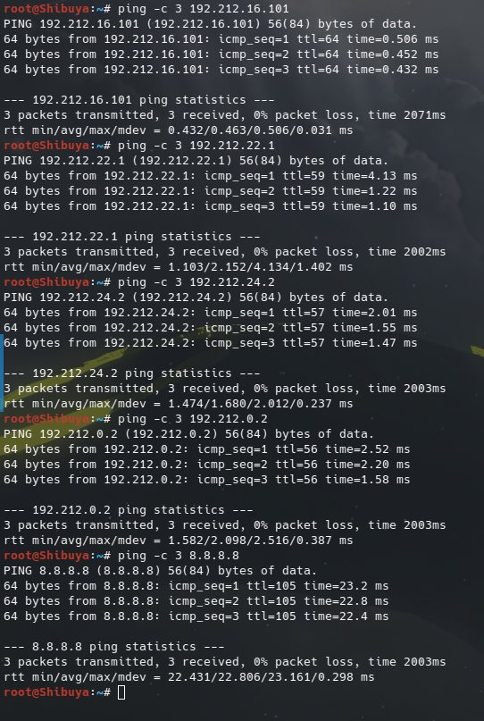
  *(Hasil: 0% packet loss, membuktikan seluruh 13 router terhubung sempurna tanpa loop)*

* **Uji Pamungkas Konektivitas Menyeluruh (Host Lain - Lapisan Terdalam The Wired)**:
  Host Lain (`192.212.16.2`) yang berada di lapisan paling dalam The Wired diuji melakukan koneksi ke setiap penjuru topologi. Hasil pengujian menunjukkan **0% packet loss (sukses penuh)** ke seluruh target:
  1. Gateway lokal Shibuya (`192.212.16.1`)
  2. Host tetangga Mika (`192.212.16.3`)
  3. Server Eiri (`192.212.16.130`) pada Router Knights
  4. Host Alice (`192.212.24.2`) di Sayap Kanan
  5. Host Omnipresence (`192.212.0.2`) di Sayap Kiri
  6. Host JJ (`192.212.28.2`) di LAN Cyberia
  7. Internet Publik (`8.8.8.8`) melalui NAT Cyberia

  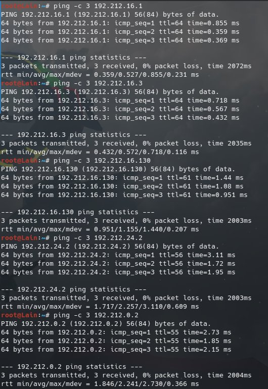
  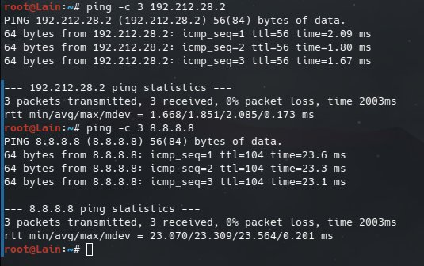

---
